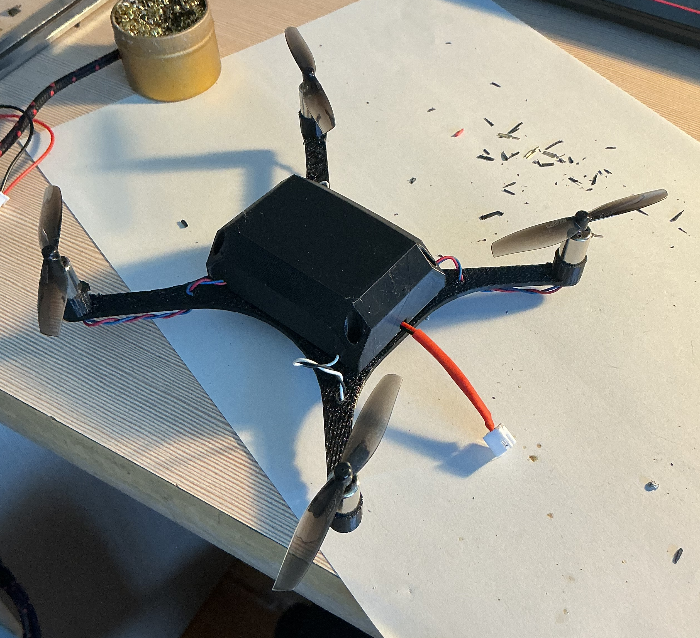
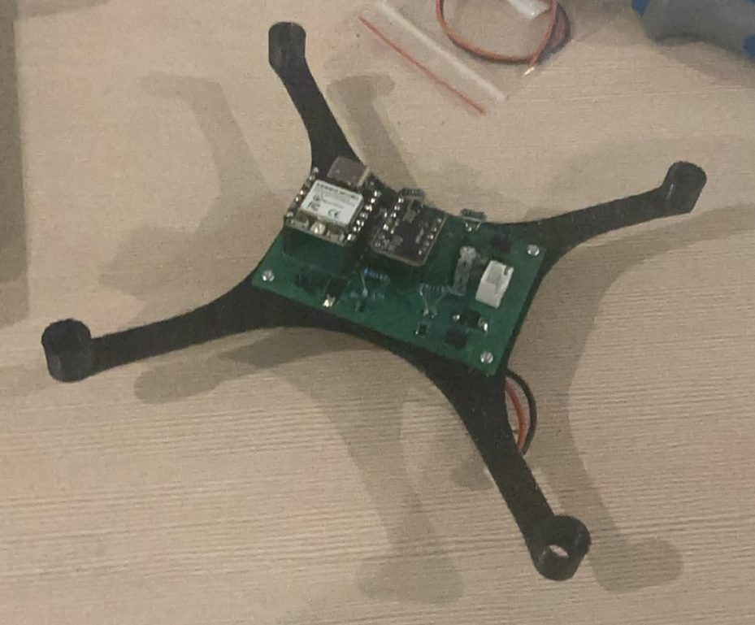
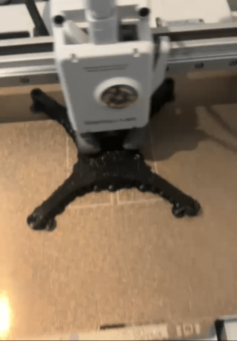
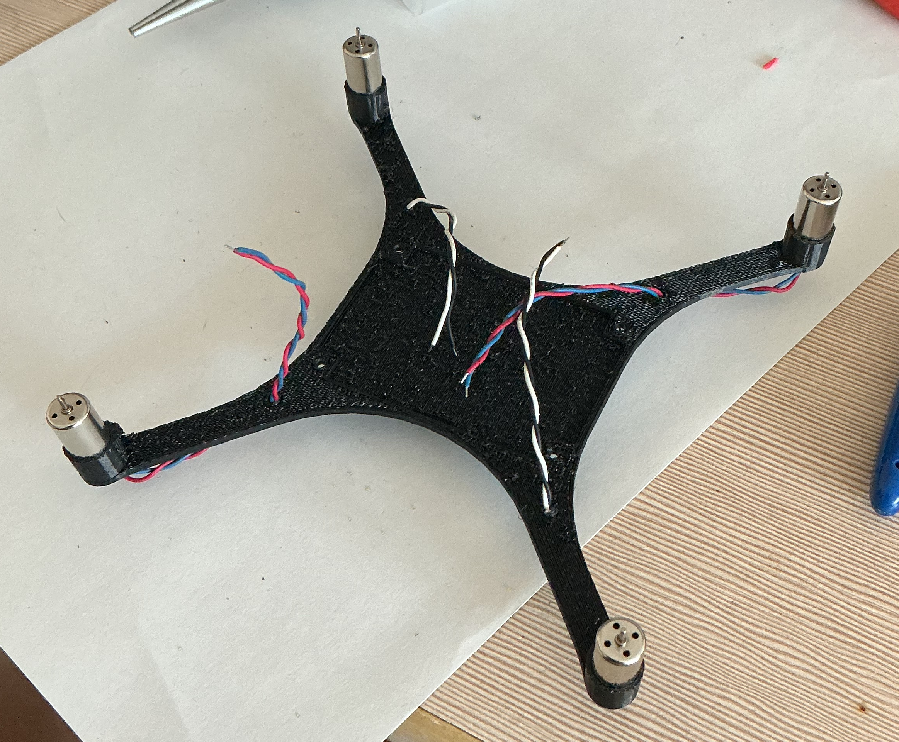

# ESP32-C3 Mini Quadcopter

> **Project Status: Work in Progress**  
> Custom PCB (Rev 1.0), 3D-printed airframe, and final hardware assembly are complete. Firmware development is currently paused halfway through to finalize the ESP-NOW communication protocol with the custom handheld controller.

<p align="center">
  
  
</p>

A lightweight, custom-built mini quadcopter engineered from scratch — covering KiCad PCB design, discrete MOSFET motor drivers, 3D-printed mechanics, and modular C++ flight firmware built around the **Seeed Studio XIAO ESP32-C3**.

---

## Development Story & Design Goals

The primary goal of this project was simple: **design a compact, custom-built quadcopter from the ground up and get it flying**, moving beyond off-the-shelf flight controllers into custom PCB design and ECAD–MCAD integration.

* **Scope & MCU Trade-off:** Early in the concept phase, I considered adding a small onboard camera for video recording. However, because the **ESP32-C3** is a single-core RISC-V microcontroller, handling real-time flight stabilization alongside video streaming/recording would compromise control loop reliability. I deliberately narrowed the scope to focus purely on flight control and low-latency wireless communication via **ESP-NOW**.
* **ECAD–MCAD Workflow:** This was my first project integrating a custom KiCad board directly into an Autodesk Inventor mechanical assembly (`cad/drone_assembly.stp`) to verify mounting clearances, motor spacing, wire routing channels, and canopy fit before 3D printing.

<p align="center">
  
  
</p>

---

## Hardware Architecture & Bill of Materials

The propulsion stage uses four discrete low-side N-channel MOSFET switches integrated directly onto the custom PCB. Each channel includes an **SS14** Schottky flyback diode to suppress inductive voltage spikes and a **10 kΩ** gate pull-down resistor to prevent unintended motor spin-up during boot. A **470 µF** bulk electrolytic capacitor sits across the battery rail to mitigate voltage sag under load.

| Component | Specification | Qty | Role |
| :--- | :--- | :---: | :--- |
| **Microcontroller** | Seeed Studio XIAO ESP32-C3 (RISC-V, 3.3V) | 1 | Flight controller & ESP-NOW wireless link |
| **IMU Sensor** | GY-BMI160 (6-axis accel + gyro, I2C) | 1 | Attitude and angular rate estimation |
| **Motors** | 8520 Coreless Brushed DC (8.5 × 20 mm, CW/CCW) | 4 | Quadcopter propulsion |
| **Motor Drivers** | AO3400A N-MOSFET (SOT-23, 30V / 5.8A, 1.4W) | 4 | Logic-level PWM motor switching |
| **Flyback Protection** | SS14 Schottky Diode (SMB package) | 4 | Inductive spike suppression across motors |
| **Gate Pull-downs** | 10 kΩ Resistors (`R1`–`R4`) | 4 | Keep MOSFET gates low during MCU reset |
| **Bulk Decoupling** | 470 µF Electrolytic Capacitor (`C1`) | 1 | Stabilize 1S LiPo rail during current spikes |
| **Battery** | 1S LiPo 3.7V 600 mAh (30C discharge) | 1 | Main power supply |
| **Airframe & Canopy** | Custom 3D-printed frame & electronics cover | 1 set | Mechanical structure & PCB protection |

---

## Rev 1.0 Errata & Lessons Learned

This board is my **first custom PCB designed in KiCad**. Bringing up Rev 1.0 surfaced three real-world hardware issues that taught me a lot about moving from schematic to physical hardware:

1. **SOT-23 MOSFET Pinout Mismatch:**  
   Using default KiCad MOSFET footprints resulted in a pinout mismatch against the actual AO3400A SOT-23 datasheet. Rather than stalling the project for a second PCB spin, I manually reworked the board by soldering the transistors inverted and angled to match the required Gate–Drain–Source routing.
2. **SMD vs. THT Resistor Sourcing:**  
   The PCB was laid out with 0805 SMD resistor pads (`R1`–`R4`), but due to small-batch component sourcing and shipping costs, standard through-hole (THT) 10 kΩ resistors were adapted and soldered directly onto the SMD pads (visible on the assembled PCB photo above).
3. **Power Rail Conflict (`VBUS` vs. `VBAT`):**  
   In Rev 1.0, the 1S LiPo rail (`+BATT`) was routed to the XIAO's `VBUS` pin (5V USB rail) instead of the dedicated `VBAT` pad. **Hardware constraint:** USB-C and the LiPo battery must *never* be connected simultaneously on Rev 1.0 to avoid back-feeding 5V into the 3.7–4.2V LiPo cell.

**Key Takeaways for Rev 2.0:**
* Always verify physical component datasheets directly against KiCad symbol-to-footprint pin mappings before generating Gerbers.
* Finalize the BOM before locking package sizes.
* Route battery power strictly to `VBAT` (or add proper power-path isolation) and add 100–220 Ω series gate resistors between the ESP32 GPIO pins and MOSFET gates.

---

## Software Architecture

The firmware is developed in **PlatformIO** (C++ / Arduino framework) on top of my custom modular framework — [**Robot Management System (RMS)**](https://github.com/prox1602/Robot-Management-System).

Instead of a monolithic `loop()`, responsibilities are split into decoupled classes inheriting from `IController`. Each controller automatically registers itself with the singleton `DeviceController` upon instantiation and implements its own `setup()` and `update()` lifecycle methods. Data is exchanged asynchronously without direct class coupling via RMS primitives (`Service`, `Buffer`, `DataBase`):

* **IMU & Attitude Controller:** Interfaces with the GY-BMI160 over I2C (`DFRobot_BMI160`) and computes orientation angles.
* **ESP-NOW Communication Controller:** Manages wireless packet reception and telemetry exchange with the handheld controller.
* **Flight / Motor Controller:** Consumes attitude feedback and target setpoints to drive the 4-channel PWM MOSFET outputs.

---

## Development Progress

### Completed
* Custom PCB schematic, layout (KiCad), assembly, and Rev 1.0 hardware rework.
* 3D-printed airframe, protective canopy, motor wiring, and full ECAD–MCAD assembly.
* Core firmware architecture using RMS (IMU reading, motor driver setup, initial ESP-NOW structure).

### In Progress / Next Steps
* Finalizing the ESP-NOW packet structure and handshake protocol with the custom controller.
* Completing the flight stabilization loop (sensor filtering, PID tuning, and motor mixing).
* Bench thrust tests and maiden flight.

---

## Repository Structure

```text
├── pcb/        # KiCad project, schematic, PCB layout, and board 3D STEP model
├── cad/        # 3D-printed frame, canopy, and full drone assembly (.stp)
├── code/       # PlatformIO project and WIP ESP32-C3 firmware
├── assets/     # Build photos and media
└── LICENSE     # MIT License